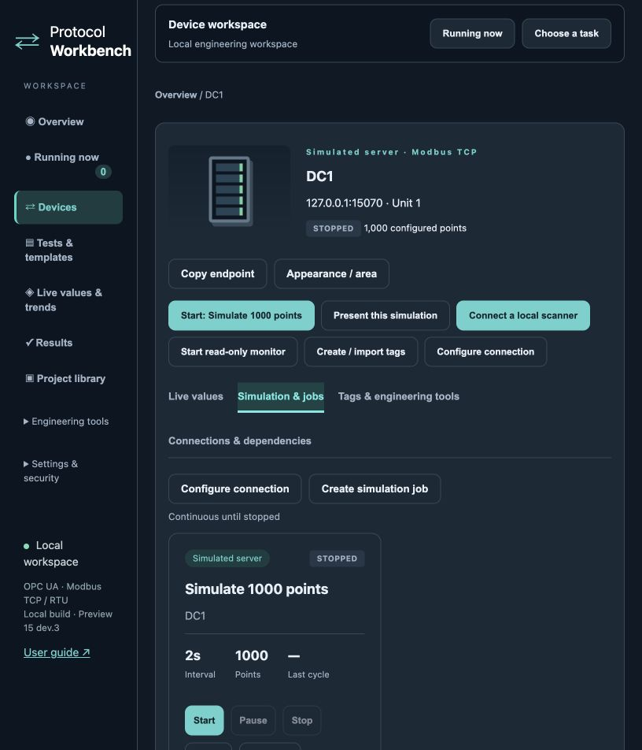
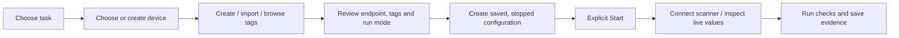

# Protocol Workbench — AI development handover

**Snapshot:** 31 October 2026 · **Version:** `2.0.0-preview.15-dev.3` · **Local development checkpoint:** `1f67e80`; the GitHub release tag identifies the public source commit.

This is a development handover for continuing the application in another AI coding tool. It contains actual latest local application source, tests, documentation and design context. It is not an installer, not a dump of the live workspace, and not a verbatim transcript of every conversation. The summary below distinguishes implemented behavior from requested improvements. Nothing was uploaded externally while creating this package.

## 1. What this application is

Protocol Workbench is a local graphical engineering application for OPC UA and Modbus simulation, inspection, protocol mapping and repeatable testing. Its GUI runs in a browser; a Python backend runs locally and performs protocol operations. It is more than a collection of standalone scripts, but remains a preview rather than a certified commercial commissioning suite.

The intended engineer should be able to create a simulated device, define/import/browse its signals, start changing values, connect a scanner, inspect communication and record test evidence without writing Python or hunting through menus. Engineers should also be able to demonstrate one selected simulated architecture to a customer, with device illustrations, endpoints, running states, animations and clear data paths.

The originating use case was a Siemens S7-1500 HA OPC UA server: write dynamic REAL values to PLC DBs, with a downstream Modbus view. Later requirements expanded to generic multi-device scenarios, reusable templates, local simulators, OPC UA browsing/import, Modbus TCP/RTU, bridges and automation. The old DB1/DB2 setup was a one-time test, not a hard-coded product feature. Do not restore customer addresses or samples as automatic defaults.

**Use boundary:** local simulators and isolated test equipment. Do not market this snapshot as production-ready, safety-certified, bug-free, or an unrestricted open-source product. Source availability and permission to redistribute are separate questions.

## 2. Owner’s product direction and constraints

- Community-oriented engineering tool; engineers should eventually create, copy, import and share simulation/test templates.
- Keep the option to commercialize later. Do not add an open-source licence, change ownership, sign agreements or publish source without explicit owner authorization.
- The owner previously requested public GitHub identity rather than personal name/email in distributed licence material. This local branch contains historical legal drafts and personal publisher defaults; reconcile them before any external distribution. This export preserves source rather than silently changing licensing behavior.
- Desired look: dark navy surfaces, teal accents, green running indicators, clean typography and illustrated industrial devices. Device symbols are UI representations, not equipment physics models.
- Industries: data centre, pharma and manufacturing, plus common PLC/HMI/gateway/meter/tank/pump equipment.
- A project/presentation view must show only chosen devices and related paths. Hiding devices must never stop unrelated work.
- All existing protocol adapters, GUI features and saved configurations must survive UI refactoring.
- Create a Git checkpoint before code changes. A failing regression test blocks activation and further implementation phases until resolved.
- Keep development separate from the currently running installation and its data. No test writes to a PLC or other external device without explicit authorization.
- Restart only after successful checks and with awareness that monitors/jobs stop. Saved configuration should remain unchanged.
- No GitHub upload is authorized by this handover alone.

## 3. Repository layout

- `source/app`: current Python backend and browser GUI.
- `source/tests`: Python and Node regression tests.
- `source/tools`: UI regression runner, qualification and existing native acceptance tools.
- `source/guides`, `source/examples`: feature documentation and local examples.
- `source/packaging`: existing installer scripts; native release preparation requires separate validation.
- `ProtocolWorkbench/licenses`: third-party notices.
- `docs/Preview_15_dev3.md`: current source release notes.
- `docs/UX_Fix_Validation.md`: local usability-fix validation.

The public source has GitHub-only publisher metadata. Runtime/user data, installed runtimes, private Git history and private handover references are excluded. The development handover does not override [PERMITTED_USE.md](PERMITTED_USE.md). References below to historical audits/prototypes describe local design context; those private reference folders are not bundled in the public release.

## 4. Stack and dependencies

- Python backend: `aiohttp`; launch via `app/launcher.py`.
- OPC UA: **`asyncua==2.1.0`**.
- Modbus: **`pymodbus==3.11.4`**; serial support via **`pyserial==3.5`**.
- Other pinned runtime dependencies: cryptography, reportlab, Pillow, charset-normalizer; exact versions in `requirements.txt`.
- Frontend: existing HTML/CSS and JavaScript modules loaded as global scripts in a defined order. There is no npm frontend build step.
- Regression tests: pytest 9.0.2; Node.js for `tests/browser/*.test.cjs` (validated locally with Node 22).
- Persistence: JSON workspace and SQLite catalogues/history/settings; data directory selected by `WORKBENCH_DATA`.
- Native CI currently specifies Python 3.13. Use Python 3.13 as the initial development target; test dependency availability on the chosen OS/architecture. A supported architecture is not proven by a filename alone.

## 5. Run a separate fresh development instance

Open a terminal in `source`. Keep this directory separate from any installed copy. Use a fresh data directory and port **8890**, avoiding the owner’s existing 8877 instance.

### macOS / Linux

```sh
python3.13 -m venv .venv
.venv/bin/python -m pip install -r requirements-dev.txt
export WORKBENCH_DATA="$PWD/dev-data"
export WORKBENCH_PORT=8890
.venv/bin/python app/launcher.py start --no-ui
```

Then open `http://127.0.0.1:8890/`. Status and stop:

```sh
.venv/bin/python app/launcher.py status
.venv/bin/python app/launcher.py stop
```

### Windows PowerShell

Install a Python 3.13 interpreter appropriate to the guest OS architecture, then:

```powershell
py -3.13 -m venv .venv
.\.venv\Scripts\python.exe -m pip install -r requirements-dev.txt
$env:WORKBENCH_DATA = Join-Path $PWD 'dev-data'
$env:WORKBENCH_PORT = '8890'
.\.venv\Scripts\python.exe app\launcher.py start --no-ui
```

Open the same local URL. Use the same interpreter, environment and directory for `status` or `stop`:

```powershell
.\.venv\Scripts\python.exe app\launcher.py status
.\.venv\Scripts\python.exe app\launcher.py stop
```

A Windows VM on Apple Silicon is normally Windows ARM64; verify the guest architecture. Do not substitute an x86 or x64 runtime and label it native ARM64. Missing dependency wheels need separate validation.

Startup may present an acknowledgement or authentication flow depending on local data. Do not bypass it in source. No simulation must start merely because a page opens. If port 8890 is occupied, choose another unused port in the allowed range 1024–65535.

## 6. Mandatory regression procedure

From `source`, after installing dependencies:

```sh
python -m pytest tests -q
python tools/run_ui_regressions.py
```

Use `.venv/bin/python` on macOS/Linux or `.\.venv\Scripts\python.exe` on Windows in place of `python` if the terminal is not using that environment. Node must be on PATH for the second command. No npm install is required.

Tests start local TCP listeners, OPC UA servers and serial/virtual-port fixtures. Sandboxes must allow loopback sockets. Socket-permission failures are environmental failures, not evidence that application behavior passed. Do not suppress failed tests or weaken assertions to release a build.

Latest original-source validation: **729 Python tests passed, 378 warnings**, approximately 124 seconds; all four Node regression files passed. Warnings were retained, not treated as a guarantee of harmlessness. See the release notes for validation of the published source tree.

### Regression coverage map

| Tests | Purpose |
|---|---|
| transactions, signal_path, bulk_signal_path | Per-point write outcomes, unknown/partial operations, write/readback path evidence |
| data_verification, tag_settings, mixed_tags, tag_builder | Datatypes, simulation behavior, tag generation and validation |
| live_monitor, live_write, watchlists_recording | Acquired values, explicit writes, trends/watchlists and recording |
| rtu, rtu_demo | Serial transport, RTU simulator and isolated demo lifecycle |
| scenarios, scenario_automation, scenario_editing, concurrency | Test execution, snapshots, cancellation, ownership and conflicts |
| server_import, device_setup, simulation_wizard | Browse/import/create and onboarding |
| bridge, communication_health, performance | Mapping/delivery evidence, recovery state and measurement |
| project_library, library_lifecycle, recovery, process_recovery | Persistent definitions, recovery, archive/restore and restart handling |
| access_control, licensing, engineering_reports, packaging | Roles, notices, reports and installer safeguards |
| browser/scanner_refresh.test.cjs | Repeated reads must not navigate away or remount live tables |
| browser/presentation_scope.test.cjs | Selected presentation scope excludes unrelated devices/jobs/links |
| browser/engineer_ux.test.cjs | Ownership links, scenario association and stable polling |
| browser/usability_context.test.cjs | Role guard, lifecycle buttons, route restore and inspector action state |

The Node files use VM/DOM stubs; they are not a full browser automation suite. After changes also exercise actual screens and check keyboard, narrow-screen and error states.

## 7. Architecture: where to make changes

```text
Engineer → Browser GUI → Local aiohttp API
                              ├─ Workspace jobs → Engine → OPC UA / Modbus adapters
                              ├─ Read-only monitors → subscriptions / polling → live evidence
                              ├─ Scenario runner → run-owned jobs and recorded step results
                              └─ Catalogues / reports / recovery → local files and SQLite
```

| Module | Responsibility |
|---|---|
| `app/server.py` | App composition, middleware, API registration and bootstrap |
| `app/launcher.py`, `runtime_lock.py` | Background process lifecycle and single-instance data locking |
| `app/model.py` | Project validation, datatype/address constraints and limits |
| `app/drivers.py` | OPC UA/Modbus client reads and writes |
| `app/engine.py`, `simulation_control.py`, `typed_patterns.py` | Jobs, cycle execution and generated values |
| `app/transactions.py`, `transaction_api.py`, `verification.py` | Per-point outcomes and verification evidence |
| `app/live_monitor.py`, `live_write.py`, `recordings.py`, `watchlists.py` | Acquisition, reviewed writes and persistent selections/CSV recording |
| `app/scenarios.py`, `scenario_automation.py`, `scenario_api.py` | Independent saved scenario snapshots and test runs |
| `app/bridge.py`, `bridge_api.py` | Transformations and delivery evidence |
| `app/server_import.py`, `device_setup.py`, `simulation_wizard.py` | Browsing/importing and guided device/simulator drafts |
| `app/project_library.py`, `project_api.py` | Project storage and library management |
| `app/recovery.py`, `config_changes.py`, `credential_vault.py` | Draft/change recovery and credential handling |
| `app/access_control.py`, `write_access.py`, `certificate_access.py` | Authorization, write and certificate boundaries |
| `app/engineering_reports.py`, `event_log.py`, `report_pdf.py` | Recorded evidence, structured events and exports |
| `app/static/index.html` | Navigation shell and global script load order |
| `app/static/app.js` | Core render/bind, tags, connections and job forms/cards |
| `app/static/architecture.js`, `presentations.js` | Device workspace, illustrations, actual relationships and presentation scope |
| `app/static/engineer-ux.js` | Context links, active ownership, stable refresh and navigation history |
| `app/static/task-hub.js`, `device-wizard.js`, `simulation-wizard.js` | Goal-driven setup and source/destination route form |
| `app/static/live-inspector.js`, `watchlists.js` | Live inspector, trends, session selection and recording UI |
| `app/static/tag-editor.js`, `tag-builder.js`, `mixed-tags.js` | Dense editable table, bulk creation and mixed signal generation |
| `app/static/reporting.js`, `data-verification.js` | Named evidence/job selectors and report workflow |

Important coupling: several frontend modules wrap `render`, `studioRefresh` or `refreshInspector`. Preserve script order and mounted-node behavior until deliberately refactored with tests. Polling must not replace the selected page, reset forms, lose keyboard focus or regenerate the live table on every sample.

OPC UA writing is implemented by the OPC UA driver's `write` method in `drivers.py`. It batches `client.write_values(..., raise_on_partial_error=False)` and examines returned statuses. Read that implementation and its transaction tests before changing it. Never count a batch as successful merely because no exception was raised. Preserve per-tag failed and unknown outcomes; an acknowledgement does not prove physical delivery. Do not blindly replay an unknown write on reconnect.

## 8. Current capability boundaries

Implemented areas include OPC UA client/server simulation, browsing/import to a separate stopped simulation, Modbus TCP/RTU scanning and simulation, dynamic tag patterns, mixed tag editing, bridges, independent scenarios, verification, reports, watchlists/recordings, recovery, role controls, project/template libraries and selected architecture presentations. Read current source/tests when an older guide disagrees.

- Validation permits **20,000 tags per connection**. This is a configuration cap, not a measured sustainable rate for every protocol/device/PC.
- OPC UA server import has separate traversal bounds: 20,000 supported tags, 25,000 nodes, depth 32 and reference limits. Incomplete inventories must remain visibly incomplete.
- Some onboarding browsers impose smaller result limits; do not describe every browse entry point as identical.
- Monitor and scenario concurrency are bounded; existing documented paths support up to eight. Verify admission and resource limits in source before changing them.
- Modbus register width/address limits apply independently of tag count. REAL/Float occupies two 16-bit registers; byte/word order matters.
- RTU requires serial hardware or a suitable virtual pair. A client and server cannot both own one physical serial port. End-to-end physical RS-485 validation is separate from virtual/local tests.
- Device illustrations do not implement a real bioreactor, HVAC controller or PLC scan model. Generated values are not acquired values, and animated paths must not imply measured communication without evidence.
- OPC UA events, methods, history and broader advanced UA coverage must not be claimed equivalent to UAExpert without implementation-specific proof.
- Existing native CI definitions and build scripts do not prove that a signed working installer exists for every OS/architecture.

## 9. Most recent fixes already in this snapshot

Preview 15 dev.3 fixed selected-device Back navigation, monitor preselection, Engineer role UI editing, stopped job controls, inspector actions without a monitor, refresh/Back/Forward navigation, guided bridge entry, named job/run evidence selectors, friendlier job labels, explicit workspace-replacement wording, simulator interval default and configured-port suggestions, irrelevant OPC UA Unit ID visibility and accessible tag deletion labels.

The source project checksum matched before/after activation. The running user workspace was not included in this export. Detailed evidence is in `UX_Fix_Validation.md` and the reference audits. The previous assessment was roughly **6.5/10 engineering usability**, a subjective preview assessment rather than certification or a benchmark against competitors.

## 10. Agreed next work: consistent guided setup

**This section is planned, not all implemented.** The owner agreed that the normal journey should be:

**Choose a task → configure → review → create → run → inspect results.**

First priority is one connected workflow: **create simulator → start it → connect local scanner → view live values**. Reuse the saved endpoint and tag map; do not require the engineer to rebuild the connection manually. Keep start explicit and the resulting job/device discoverable.

| Area | Requested improvement / acceptance criterion |
|---|---|
| Task entry | Simulate, Monitor, Connect protocols and Run a test are visible and consistently named. |
| Context | Device name, protocol, endpoint and job/run ownership remain visible through every wizard. |
| Tags | Create, Import file and Browse server are presented together; preview changes before saving. |
| Protocol fields | Show only TCP, serial or OPC UA fields relevant to the choice. Keep advanced capabilities accessible. |
| Run behavior | Explicit continuous vs timed operation, interval and changing-value preview. |
| Scanner handoff | “Monitor this simulator” directly reuses its endpoint/tags and explains start/connection state. |
| Bridge mapping | Visual source → tag mappings → destination; actionable errors beside the affected choice. |
| Tests/reports | Named devices/jobs/runs, clear evidence scope and no required internal IDs for normal work. |
| Review | Device, endpoint, tag count, interval, run mode and write destination summarized before creation. |
| Completion | Immediate Start now, View device, View job and Monitor values actions. Creating alone performs no I/O. |
| Cancel/errors | Preserve values, identify the specific invalid field, offer Keep draft / Discard draft deliberately. |
| Advanced controls | Normal path stays short while all existing detailed settings remain available. |

Other outstanding UX work: simplify the wide/dense editable tag table; consolidate template/profile library concepts; improve empty-state guidance and actionable dependency links throughout; test keyboard access, contrast and reduced motion. Keep the dark visual bench and industry/device illustrations. Clicking a device should expose configuration, connections, jobs and live values in context.

A future customer-environment builder should support chosen devices and actual protocol relationships, selected-view presentations, reusable architecture/test templates and clear separation of diagram-only relationships from executable mappings. It is not yet a physical digital twin. An IOT2050 reader/forwarder scenario was deferred; do not assume that deployment is part of this build.

## 11. Acceptance checklist for the next AI

1. Read this handover, inspect actual source and current audits; do not start another generic rewrite.
2. Initialize a new local Git repository/checkpoint if needed. Preserve this snapshot.
3. Run the entire Python and Node baseline before editing. Stop if a genuine regression fails.
4. Use an isolated data directory and alternate app/listener ports. Never use customer endpoints in automated checks.
5. Reproduce the target UX failure through the real browser and retain before/after evidence.
6. Add meaningful regression coverage; preserve scanner mounting, selected views and transaction semantics.
7. Review every changed journey for state, roles, running-job conflicts, cancellation, errors and empty states.
8. Run both suites again; do not hide failures or change assertions solely to obtain green output.
9. Verify saved workspace integrity and explicit start/stop behavior before activation.
10. Summarize what is fixed and what remains. Do not claim commercial readiness, universal OS support or hardware qualification from local tests.

Suggested independent usability trial: five engineers unfamiliar with the app should create a 1,000-tag simulator, start a continuous run, connect its scanner, inspect live values, save/reuse a template, find the owning job/port, stop and remove it, and present only one selected architecture. Record task completion, assistance, errors and time. This has been proposed, not completed.

## 12. Packaging and licensing caveats

`source/packaging/build_packages.py` preserves the public installer repair and runtime/dependency checks. It derives the application version from source, but retains historical output/target assumptions and needs native runtime preparation. It has not been used to produce Preview 15 installers. Update payload, paths, notices, runtime preparation, signatures and OS acceptance before making new installer claims. Existing package-audit CI checks Preview 14 release assets, not this source preview. The included Node UI checks must also be run for future builds.

No signed installer or bundled Python runtime is included here. Recreating Windows ARM64/x86/x64 installers requires native-compatible dependencies and explicit verification; signing/notarization is separate. Antivirus trust is not guaranteed by changing ZIP to EXE.

Older README, BUILD_STATUS, blueprint and phase guides contain milestone counts and outdated “still to build” sections. This handover and current tests/source take precedence for development state; reconcile documentation before publishing. Draft legal materials and local publisher defaults require owner review. No legal advice or guarantee of zero liability is included.

## 13. Prompt to paste into another AI tool

> Continue Protocol Workbench using DEVELOPMENT_HANDOVER.md and the included source. First inspect the source and run all Python and Node regressions in an isolated local workspace. Preserve every existing protocol adapter, GUI feature, saved-data format, transaction outcome, role restriction, recovery safeguard and presentation scope. Create a Git checkpoint before editing. Begin with a consistent guided create-simulator → start → connect-scanner → live-values workflow, retaining the dark illustrated device interface and explicit communication controls. Treat section 10 as the improvement backlog, not completed functionality. Do not publish, overwrite an installed workspace, contact external PLCs, change licensing or manufacture release claims. Stop implementation/activation if regression tests fail, diagnose the cause, and report exact validation and remaining limits.

## 14. Visual reference and intended journey



The local design prototypes informed this direction but are not bundled in this public source release. The screenshot shows the implemented device workspace.



Successful future UX should expose the next action at the current device, without forcing the engineer through unrelated menus.
